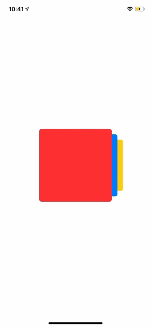

# CardStack


[](https://swift.org/package-manager)

[](https://github.com/nhoogendoorn/CardStack/releases)
[](https://github.com/nhoogendoorn/CardStack/blob/master/LICENSE)

> A SwiftUI package that lets you implement swipable cards in your project.



## Requirements

- iOS 17.0+, macOS 14.0+ or visionOS 1.0+
- Xcode 16.0+

## Installation

Add CardStack with the [Swift Package Manager](https://swift.org/package-manager/):

1. In Xcode, open your project and go to **File** → **Add Package Dependencies...**
2. Paste the repository URL (`https://github.com/nhoogendoorn/CardStack`).
3. Pick **Up to Next Major Version** and click **Add Package**.

Or add it to your `Package.swift`:

```swift
.package(url: "https://github.com/nhoogendoorn/CardStack", from: "1.0.0")
```

## Usage

> For a full example see the example project.

Pass any `Identifiable` items and a view builder for a single card. Swipe left for the next card and right for the previous one.

```swift
import SwiftUI
import CardStack

struct Item: Identifiable {
    let id = UUID()
    let color: Color
}

struct StackExampleView: View {
    private let items = [Color.red, .blue, .yellow, .green, .orange].map { Item(color: $0) }

    var body: some View {
        CardStackView(items) { item in
            item.color
                .frame(width: 200, height: 200)
                .clipShape(.rect(cornerRadius: 8))
        }
    }
}
```

VoiceOver users can move through the cards by swiping up and down on the stack.

### Configuration

Pass a `StackConfiguration` to change how the stack behaves:

```swift
CardStackView(items, configuration: StackConfiguration(startIndex: 2, numberOfCardsShown: 4)) { item in
    CardView(item: item)
}
```

| Setting | Default | What it does |
| --- | --- | --- |
| `startIndex` | `0` | The card shown first. |
| `minimumSwipingDistance` | `0` | How far a card needs to be dragged before letting go moves to the next or previous card. |
| `numberOfCardsShown` | `3` | The number of cards shown at the same time. |

### Upgrading from 0.x

The `CardData` and `CardView` protocols still work but are deprecated. Your data only needs to be `Identifiable` now, and the card view is a closure:

```swift
// Before
CardStackView<CardExampleView, DataExample>(configuration: configuration, items: items)

// After
CardStackView(items, configuration: configuration) { item in
    CardExampleView(data: item)
}
```

## Author

Niels Hoogendoorn

## License

CardStack is available under the MIT license. See the LICENSE file for more info.
